<!-- Banner anime: upload file sakura-night.svg ke root repo ini -->

 

---

## 👩‍💻 About Me

- 🎓 TODO: jurusan / kampus / status kamu
- 🔭 Lagi mengerjakan: TODO
- 🌱 Lagi belajar: TODO
- 💬 Tanya aku soal: TODO
- 🌐 Lihat semua karyaku di **[portofolio website](https://chelseas-portofolio.super.site/)**

---

## 🛠️ Tech Stack

<!-- Hapus yang tidak kamu pakai, tambah dari https://shields.io atau https://simpleicons.org -->

---

## 📌 Featured Projects

<!-- Ganti repo=NAMA_REPO dengan nama repo aslimu. Kartu ini otomatis menarik deskripsi, bahasa, dan bintang. -->

<b>👉 Klik untuk lihat detail proyek</b>

 

| Proyek | Masalah yang diselesaikan | Tools | Link |
| --- | --- | --- | --- |
| TODO nama proyek 1 | TODO | TODO | [Repo](https://github.com/chelseawzz/NAMA_REPO_1) |
| TODO nama proyek 2 | TODO | TODO | [Repo](https://github.com/chelseawzz/NAMA_REPO_2) |

---

## 📊 GitHub Stats

---

## 🌸 Anime Corner

<!--
  Mau GIF anime favoritmu? Upload GIF-nya ke repo ini (misal anime.gif),
  lalu hapus tanda komentar pada baris di bawah dan sesuaikan namanya.
  Pakai GIF yang kamu punya hak pakainya atau yang boleh dipakai ulang.

  

-->

---

⭐ Kalau ada proyek yang berguna, kasih star ya!

